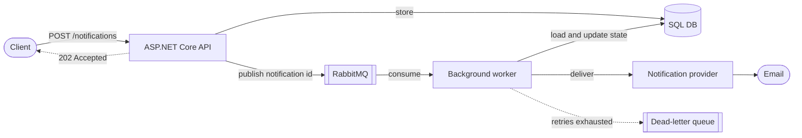
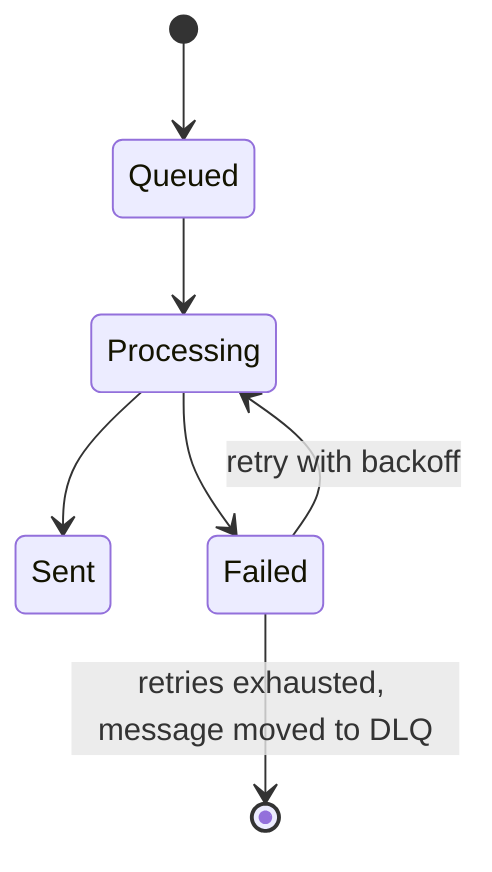

# Notification System


A small, reliable backend service for accepting notifications and delivering them asynchronously.

Clients submit a notification over HTTP. The API stores it, puts a message on RabbitMQ, and returns `202 Accepted` immediately. A background worker picks the message up, delivers the notification through a provider, and records the outcome. Failed deliveries are retried with exponential backoff and, once retries are exhausted, moved to a dead-letter queue.

The first supported channel is email, delivered through a fake provider that can simulate failures. New channels plug in behind the same provider interface without touching the processing flow.

> The goal of this project is to show how a reliable asynchronous backend is designed, not to be a large production platform. The reasoning behind each decision lives in [`docs/dd.md`](docs/dd.md).

---

## Features

- **Non-blocking API.** `POST /notifications` returns `202 Accepted` as soon as the notification is stored and queued. The client never waits on delivery.
- **Durable messaging.** RabbitMQ carries pending work. Messages contain only the notification ID, so the database stays the single source of truth.
- **At-least-once delivery.** Messages are acknowledged explicitly, only after processing has finished. A worker that crashes mid-flight never silently drops work.
- **Idempotent consumer.** Already-`Sent` notifications are never delivered twice, even if the broker redelivers the message.
- **Retries with exponential backoff.** Failed deliveries retry after 1s, 2s and 4s, with the retry count and last error persisted on the notification.
- **Dead-letter queue.** Notifications that exhaust their retries are parked in a DLQ for inspection.
- **Provider abstraction.** Delivery sits behind `INotificationProvider`, so adding SMS or push is a new class, not a redesign.
- **Persisted lifecycle.** Every notification moves through `Queued → Processing → Sent / Failed`, and the current state is always queryable.
- **Consistent errors.** Every failure returns RFC 7807 `ProblemDetails`: unhandled exceptions through a single `GlobalExceptionHandler`, validation failures through validation `ProblemDetails`, and empty error status codes such as 404 and 405 through status code pages.
- **Structured logging.** Each lifecycle event is logged with the notification ID so a notification can be traced end to end.
- **One-command local infrastructure.** Docker Compose runs PostgreSQL and RabbitMQ. All connection details come from configuration.
- **Tested.** Unit and integration tests cover the happy path, retries, dead-lettering and idempotency.

---

## How it works



### Request flow

1. The API validates the request.
2. It creates the notification in the `Queued` state and saves it to the database.
3. It publishes the notification ID to RabbitMQ.
4. It returns `202 Accepted` with the ID. The API never performs the delivery itself.

### Worker flow

For every message, the worker:

1. Loads the notification from the database.
2. Checks that it still needs processing. Already-`Sent` notifications are skipped.
3. Marks it `Processing`.
4. Attempts delivery through the notification provider.
5. Records the result: `Sent`, or `Failed` with the error and an incremented retry count.
6. Acknowledges the message once handling is complete.

### Notification lifecycle



| Status | Meaning |
| --- | --- |
| `Queued` | Stored and published, waiting for a worker. |
| `Processing` | A worker has picked it up and is attempting delivery. |
| `Sent` | Delivered successfully. `processedAt` is set. |
| `Failed` | The last delivery attempt failed. It is either waiting to be retried or has exhausted its retries and been dead-lettered. |

---

## Architecture

The solution follows a layered (clean architecture) layout. Dependencies only point inward.

```text
Web  →  Infrastructure  →  Application  →  Domain
```

| Layer | Responsibility |
| --- | --- |
| **Domain** | The `Notification` entity, `NotificationStatus`, and the state transitions (`MarkAsProcessing`, `MarkAsSent`, `MarkAsFailed`). No dependencies. |
| **Application** | Use-case logic and the abstractions the rest of the system implements: `INotificationService`, `INotificationRepository`, `IRepository<T>`, `IUnitOfWork`, `IQueue<T>`, `INotificationProvider`, plus the `NotificationDto` and `NotificationService`. |
| **Infrastructure** | EF Core persistence (`AppDbContext`, repositories, `UnitOfWork`, migrations), the RabbitMQ-backed queue, the hosted `NotificationWorker`, the notification provider, and dependency-injection wiring. |
| **Web** | Minimal API endpoints, global exception handling, logging and JSON configuration, and the composition root in `Program.cs`. |

### Project structure

```text
.
├── NotificationSystem.sln
├── docker-compose.yml            # PostgreSQL + RabbitMQ for local development
├── docs/
│   └── dd.md                     # Design document
├── src/
│   ├── Domain/
│   │   ├── Notification.cs
│   │   └── NotificationStatus.cs
│   ├── Application/
│   │   ├── DTOs/
│   │   ├── Interfaces/
│   │   └── Services/
│   ├── Infrastructure/
│   │   ├── Messaging/            # RabbitMQ queue implementation
│   │   ├── Migrations/
│   │   ├── Persistence/          # DbContext, UnitOfWork
│   │   ├── Processing/           # NotificationWorker (hosted service)
│   │   ├── Providers/            # Notification providers
│   │   ├── Repositories/
│   │   └── DependencyInjection.cs
│   └── Web/
│       ├── Endpoints/
│       ├── Exceptions/
│       ├── Extensions/
│       └── Program.cs
└── tests/                        # Unit and integration tests
    ├── NotificationSystem.UnitTests/
    └── NotificationSystem.IntegrationTests/
```

### Tech stack

| Concern | Technology |
| --- | --- |
| Runtime | .NET 10 |
| API | ASP.NET Core minimal APIs |
| Persistence | Entity Framework Core, PostgreSQL |
| Messaging | RabbitMQ |
| Background processing | ASP.NET Core hosted service (`BackgroundService`) |
| Local infrastructure | Docker Compose |
| Logging | `Microsoft.Extensions.Logging` (structured) |

---

## Getting started

### Prerequisites

- [.NET 10 SDK](https://dotnet.microsoft.com/download)
- [Docker](https://docs.docker.com/get-docker/) with Docker Compose

### 1. Clone the repository

```bash
git clone https://github.com/immodi/notification-system.git
cd notification-system
```

### 2. Start the dependencies

```bash
docker compose up -d --wait
```

This starts the dependencies and waits until both report healthy. On a clean checkout PostgreSQL may take a little while to initialize.

| Service | Port | Notes |
| --- | --- | --- |
| PostgreSQL | `5432` | Stores notification state. |
| RabbitMQ (AMQP) | `5672` | Message broker. |
| RabbitMQ management UI | `15672` | <http://localhost:15672>. Local-only default credentials are in `docker-compose.yml`. |

### 3. Run the API

```bash
dotnet run --project src/Web
```

The API listens on `http://localhost:5040`. In the `Development` environment, database migrations are applied automatically on startup, and the worker starts consuming from RabbitMQ.

### 4. Send your first notification

```bash
curl -i -X POST http://localhost:5040/notifications \
  -H "Content-Type: application/json" \
  -d '{
    "recipient": "jane@example.com",
    "subject": "Welcome",
    "message": "Thanks for signing up!"
  }'
```

```http
HTTP/1.1 202 Accepted
Location: /notifications/7c1e4a52-9b3d-4f6e-8a21-5d0c3b9e7f14

{ "id": "7c1e4a52-9b3d-4f6e-8a21-5d0c3b9e7f14" }
```

A moment later, check its status:

```bash
curl http://localhost:5040/notifications/7c1e4a52-9b3d-4f6e-8a21-5d0c3b9e7f14
```

```json
{
  "id": "7c1e4a52-9b3d-4f6e-8a21-5d0c3b9e7f14",
  "recipient": "jane@example.com",
  "subject": "Welcome",
  "message": "Thanks for signing up!",
  "status": "Sent",
  "retryCount": 0,
  "createdAt": "2026-10-29T18:30:12.481Z",
  "processedAt": "2026-10-29T18:30:13.529Z",
  "lastError": null
}
```

### 5. See the failure path

The fake provider fails for the recipient `fail@example.com`. Send a notification to that address and watch the logs. You will see the delivery attempt fail, three retries at 1s, 2s and 4s, and finally the move to the dead-letter queue.

```bash
curl -X POST http://localhost:5040/notifications \
  -H "Content-Type: application/json" \
  -d '{ "recipient": "fail@example.com", "subject": "Will fail", "message": "This one never gets delivered." }'
```

After about 11 seconds, the notification ends up as:

```json
{
  "status": "Failed",
  "retryCount": 4,
  "processedAt": null,
  "lastError": "Simulated provider failure"
}
```

The dead-lettered message is visible in the RabbitMQ management UI.

---

## API reference

### `POST /notifications`

Creates a notification and queues it for delivery.

**Request body**

| Field | Type | Rules |
| --- | --- | --- |
| `recipient` | string | Required. Must be a valid email address. |
| `subject` | string | Required. 1 to 100 characters. |
| `message` | string | Required. 1 to 1000 characters. |

**Responses**

| Status | Description |
| --- | --- |
| `202 Accepted` | The notification was stored and queued. The body contains its `id`, and the `Location` header points to its status URL. |
| `400 Bad Request` | Validation failed. Returns a validation `ProblemDetails` response. |
| `500 Internal Server Error` | Unexpected failure. Returns a `ProblemDetails` response. |

Example validation error:

```json
{
  "title": "One or more validation errors occurred.",
  "status": 400,
  "errors": {
    "Recipient": ["The Recipient field is not a valid e-mail address."]
  },
  "traceId": "00-00000000000000000000000000000000-0000000000000000-00"
}
```

### `GET /notifications/{id}`

Returns the current state of a notification.

| Status | Description |
| --- | --- |
| `200 OK` | The notification, including `status`, `retryCount`, `processedAt` and `lastError`. |
| `404 Not Found` | No notification exists with that ID. Returns a `ProblemDetails` response. |

---

## Reliability

### Retries and dead-lettering

A failed delivery is recorded on the notification (`status`, `retryCount`, `lastError`) and retried with exponential backoff. By default a notification gets one initial attempt plus three retries:

| Attempt | Wait before attempt |
| --- | --- |
| 1 (initial) | none |
| 2 (1st retry) | 1 second |
| 3 (2nd retry) | 2 seconds |
| 4 (3rd retry) | 4 seconds |

If the last attempt also fails, the notification stays `Failed` in the database and its message is moved to the dead-letter queue. `retryCount` counts failed delivery attempts.

### RabbitMQ topology

| Component | Purpose |
| --- | --- |
| Notifications exchange | Entry point the API publishes to. |
| Main queue | Pending work consumed by the background worker. |
| Retry queue | Holds failed messages for the backoff delay, then routes them back to the main queue. |
| Dead-letter queue | Holds messages whose retries are exhausted, for inspection and manual replay. |

Messages are acknowledged only after the worker has finished handling them: either the notification was delivered, or the failure has been recorded and handed off to a retry or the DLQ. If the worker is killed mid-flight, the broker redelivers the message and the restarted worker picks it up.

### Idempotency

The notification ID is the stable identity of a notification. Before delivering, the worker checks the current state in the database and skips anything already `Sent`, which protects against duplicate messages from the broker. The worker owns all state transitions and persistence; the provider only delivers.

---

## Configuration

Infrastructure settings come from standard ASP.NET Core configuration: `appsettings*.json`, environment variables, or user secrets. In environment variables, use `__` as the section separator (for example `RabbitMq__Host`).

| Key | Description | Local default |
| --- | --- | --- |
| `ConnectionStrings:DefaultConnection` | PostgreSQL connection string. | Matches `docker-compose.yml` |
| `RabbitMq:Host` | RabbitMQ host name. | `localhost` |
| `RabbitMq:Port` | RabbitMQ AMQP port. | `5672` |
| `RabbitMq:Username` / `RabbitMq:Password` | RabbitMQ credentials. | Local-only defaults from `docker-compose.yml` |
| `Delivery:MaxRetries` | Retries after the initial attempt. | `3` |
| `Delivery:BaseDelaySeconds` | Base delay for exponential backoff. | `1` |
| `ASPNETCORE_ENVIRONMENT` | Set to `Development` to auto-apply migrations on startup. | `Development` via `launchSettings.json` |

### Database migrations

Migrations are applied automatically on startup in `Development`. In any other environment, apply them explicitly:

```bash
dotnet ef database update --project src/Infrastructure --startup-project src/Web
```

To add a new migration:

```bash
dotnet ef migrations add <Name> --project src/Infrastructure --startup-project src/Web
```

---

## Observability

Errors are returned as `ProblemDetails`. Unhandled exceptions are handled by a single `GlobalExceptionHandler`, which also logs the exception with the request method and path. Validation failures and empty error status codes such as 404 and 405 are converted to `ProblemDetails` by the framework. No endpoint implements its own error handling.

Every major lifecycle event is logged with the notification ID as a structured property, so you can filter by `NotificationId` and follow one notification from request to outcome:

```text
Notification queued
Notification processing
Notification delivered
Notification failed
Notification retrying
Notification moved to dead-letter queue
```

Replayed messages for already-sent notifications log `already sent` and do nothing else.

---

## Testing

```bash
dotnet test
```

Unit tests run with no external dependencies. Integration tests need Docker running: they use Testcontainers to start PostgreSQL 17 and RabbitMQ 4 automatically, run the real API host and worker, and assert the end-to-end behaviour.

The suite covers the scenarios defined in the design document:

| Scenario | Covered |
| --- | --- |
| Notification is accepted and stored | ✅ |
| Notification is published for processing | ✅ |
| Notification is successfully delivered | ✅ |
| Notification failure triggers a retry | ✅ |
| Retry exhaustion results in dead-lettering | ✅ |
| Already-sent notifications are not delivered again | ✅ |
| Notification status can be retrieved | ✅ |

Both complete paths are verified end to end:

- **Success:** `Queued → Processing → Sent`
- **Failure:** `Queued → Processing → Failed → Retry → Failed / DLQ`

---

## Extending the system

### Adding a notification channel

Delivery is isolated behind a single interface:

```csharp
public interface INotificationProvider
{
    Task SendNotificationAsync(Notification notification, CancellationToken cancellationToken = default);
}
```

To replace the bundled email provider with another channel such as SMS or push, implement `INotificationProvider` in `Infrastructure/Providers` and replace the registration in `DependencyInjection.cs`. The worker, queue, retry policy and API stay unchanged. Throwing from the provider marks the attempt as failed and triggers the normal retry flow.

To support several channels at the same time, add a channel field to `Notification` and a resolver that selects the matching provider. The delivery pipeline itself still does not change.

---

## Design notes and known limitations

This project keeps its trade-offs visible rather than hiding them behind extra machinery.

- **At-least-once, not exactly-once.** There is a small window between a successful send and the message acknowledgement. If the worker dies inside it, the message is redelivered. The `Sent` check covers the common case, but a production system would need idempotency guarantees at the provider or messaging boundary too.
- **Database write and publish are not atomic.** A notification is saved first and then published. If publishing fails after the save, the notification stays `Queued` with no message. The outbox pattern (see the roadmap) closes this gap.
- **Fake provider only.** The bundled email provider simulates delivery and failure. It does not send real email.

---

## Roadmap

Ideas for extending the core system, as outlined in the [design document](docs/dd.md):

- **Outbox pattern** for consistency between database changes and message publishing
- **Multiple notification channels:** SMS, push and others
- **Scheduled notifications** delivered at a future time
- **Priority handling** so urgent notifications are processed ahead of normal work
- **Metrics and monitoring:** delivery rates, retry counts, failures and processing latency
- **Authentication and authorization** to control who can submit and inspect notifications

---

## Documentation

The full design, including the reasoning behind each architectural decision, is in [`docs/dd.md`](docs/dd.md).
